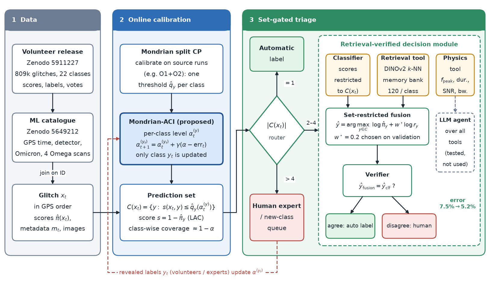

# ConfTriage-GS

Code and results for the paper

> **Silent failure of conformal prediction across LIGO observing runs: class-conditional adaptive calibration and retrieval-verified glitch triage**
> Kamran Qadir, Sohaib Sulman (submitted)



## Overview

We test the exchangeability assumption that underlies conformal prediction (CP) for Gravity Spy glitch classification:

1. **Silent failure across runs.** CP calibrated on earlier LIGO observing runs keeps ~90% marginal coverage on later runs. However, the coverage of single glitch classes drops to 7–44%.
2. **Mondrian-ACI (proposed).** This is class-conditional adaptive conformal inference: one miscoverage level per class, updated only when a label of that class is revealed. It restores worst-class coverage to 0.81–0.88, close to an oracle calibrated on the target run.
3. **Set-gated triage.** Each prediction set is routed by its size:
   - Singletons are labelled automatically.
   - Large sets go to a human.
   - Ambiguous sets (2–4 labels) are resolved by fusing classifier scores with DINOv2 image retrieval inside the set, and verified by agreement with the classifier.

   We also evaluate a vision–language model (Qwen2.5-VL) and a tool-using LLM agent. Neither beats the classifier, and both results are reported as-is.

| Experiment | Question |
|---|---|
| E0 | Reproduce Malz et al., PRD 111, 084078 (2025) |
| E1 | LAC / APS / RAPS × marginal / Mondrian / clustered CP on the full data |
| E2 | Calibration across observing runs: split, weighted CP, ACI, rolling, Mondrian-ACI |
| E3 | Unseen glitch classes (leave-k-classes-out) |
| E4 | Label source: final label vs. independent volunteer majority |
| E5 | Vision–language model restricted to the conformal set |
| E6 | Retrieval, fusion, verifier and tool-using LLM agent |

## Repository layout

```
kaggle/conftriage_gs.py   all experiments (E0–E6), Jupyter-style "# %%" cells
kaggle/make_ipynb.py      converts it to a Kaggle notebook + kernel-metadata.json
scripts/make_tables.py    results -> LaTeX tables and figures (paper/tables, paper/figs)
scripts/make_arch.py      pipeline diagram
results/v2_3B             run with Qwen2.5-VL-3B (E5)
results/v3_7B             run with Qwen2.5-VL-7B and Mondrian-ACI (E0–E5)
results/v4_E6             retrieval / fusion / tool-agent run (E6)
paper/                    generated tables and figures
```

## Reproducing

The experiments run as a single Kaggle notebook on a T4 GPU with internet enabled. The notebook downloads the data itself.

1. Generate the notebook:

   ```bash
   python kaggle/make_ipynb.py YOUR_KAGGLE_USERNAME
   ```

2. Push and run it on Kaggle:

   ```bash
   kaggle kernels push -p kaggle
   ```

3. Download the outputs into `results/`.

4. Regenerate the tables and figures from the stored results:

   ```bash
   python scripts/make_tables.py
   ```

   ```bash
   python scripts/make_arch.py
   ```

To smoke-test the pipeline locally on synthetic data, set `CT_SYNTH=1`. The image experiments are skipped in this mode.

## Data

All data are public:

- Gravity Spy volunteer classifications, O1–O3b: [Zenodo 5911227](https://doi.org/10.5281/zenodo.5911227)
- Gravity Spy machine-learning catalogue (GPS time, detector, Omicron metadata, Omega-scan URLs): [Zenodo 5649212](https://doi.org/10.5281/zenodo.5649212)

## Acknowledgements

This work uses data from the Gravity Spy project and the LIGO Scientific Collaboration. We thank the National University of Computer and Emerging Sciences (FAST-NUCES), Islamabad, for providing the computing environment.

## License

MIT
